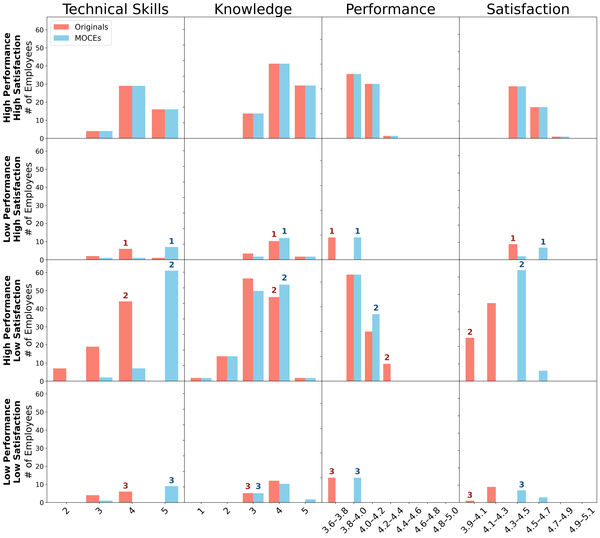
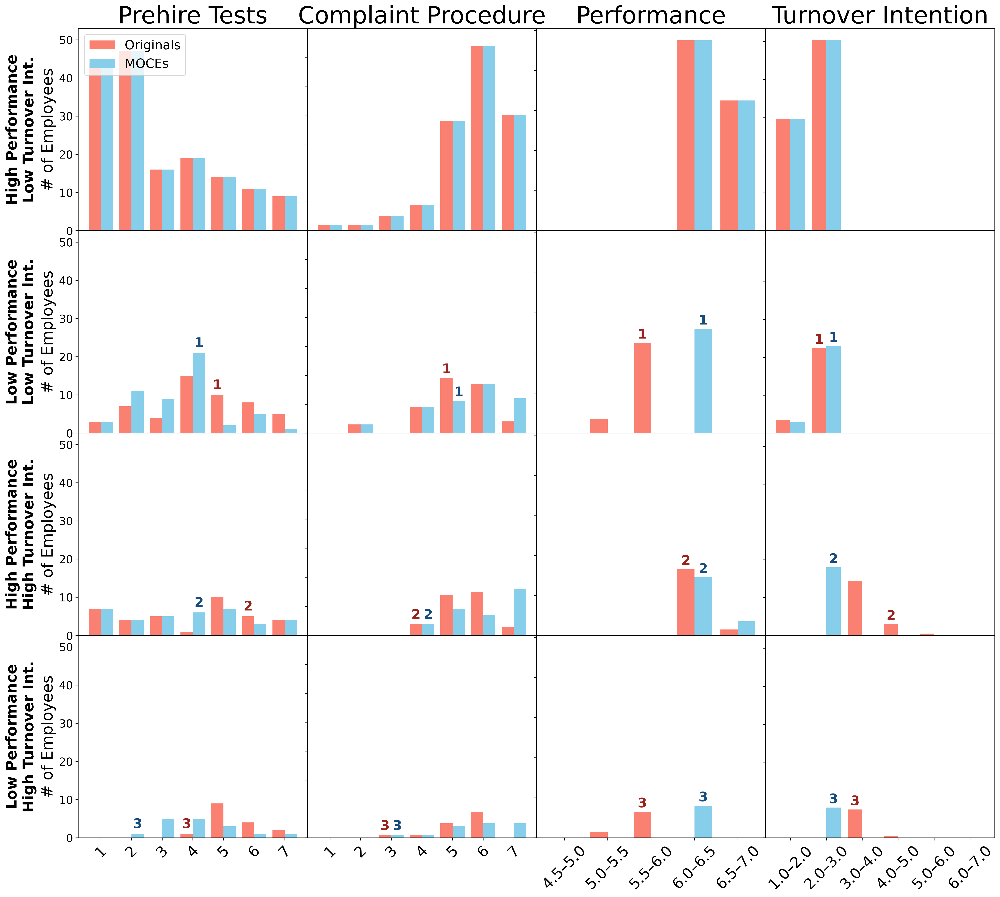

# Multi-Outcome Counterfactual Explanations for Decision Support in Human Resource Management

This repository contains the **data and Python source code** for the empirical analyses accompanying a research manuscript. It implements **multi-outcome counterfactual explanations (MOCEs)** using fitted predictive models and constrained optimization. The analyses compare MOCEs with single-outcome counterfactual explanations (CEs) and sequential single-outcome procedures, and examine sensitivity to alternative outcome requirements.

The three case studies illustrate distinct decision-support settings:

| Setting | Dataset | Variables allowed to change | Predicted outcomes | Predictive model |
| --- | --- | --- | --- | --- |
| Employee development planning | `Data-Skills.csv` (138 employees) | Seven skills; integer increases only, within 1–5 | Performance and job satisfaction | Multi-output Random Forest: 150 trees, depth 4, min. leaf 6 |
| Diagnostic explanation | `Data-Big5.csv` (268 employees) | Five Big Five personality traits; changes in either direction, within 1–7 | Performance and stress | Multi-output Random Forest: 150 trees, depth 4, min. leaf 6 |
| Organizational intervention design | `Data-HRM.csv` (264 employees) | Fifteen HRM practices; changes in either direction, within 1–7 | Performance and turnover intention | Multi-output Random Forest: 150 trees, depth 6, min. leaf 3 |

In each setting, other employee characteristics remain fixed during counterfactual optimization. **Big Five profiles are diagnostic contrasts, not proposed personality interventions.** The HRM and skills examples are model-based decision-support exercises, not causal estimates of intervention effects.

## Repository structure

```text
MOCE/
├── README.md
├── Case Study Design Overview Flowchart.png
├── Skills.png
├── Big Five.png
├── HRM.png
├── LICENSE
├── .gitignore
├── requirements.txt
├── Data-Skills.csv
├── Data-Big5.csv
├── Data-HRM.csv
├── Skills.py
├── Big Five Personality.py
├── HRM Practices.py
├── Cross-setting Summary.py
├── compare_predictive_models.py
├── selected_models.py
├── moce_evaluation.py
├── ce_helpers.py
├── constraint_learning.py
└── embed_mip.py
```

- **`Skills.py`, `Big Five Personality.py`, `HRM Practices.py`**: Fit the selected predictive model, validate predictive performance, compute single-outcome CEs, sequential CEs, and MOCEs, assess threshold sensitivity, and generate illustrative cases and distribution figures.
- **`selected_models.py`**: Stores the selected Random Forest configurations, fits the multi-output models to each full analytical dataset, and exports the tree constraints needed by the optimizer.
- **`compare_predictive_models.py`**: Compares six predictive model families (decision trees, Random Forest, Gradient Boosting, MLP, linear regression, and LinearSVR) with repeated cross-validation. This is a *model-selection analysis*, separate from the counterfactual optimization runs. It does **not** automatically rewrite `selected_models.py`.
- **`moce_evaluation.py`**: Implements common validation, CE/sequential/MOCE comparisons, threshold sensitivity, result reporting, and optional checkpointing.
- **`ce_helpers.py`, `constraint_learning.py`, `embed_mip.py`**: Implement the optimization formulation and embedding of fitted models into mathematical optimization problems.
- **`Cross-setting Summary.py`**: Combines output tables from all three case studies after they have been run.

## Case-study design overview

The three case studies share a common evaluation design: predictive-model selection and validation, specification of outcome and feasibility requirements, generation of outcome-specific and sequential counterfactuals, and generation of jointly constrained MOCEs. The design also evaluates sensitivity to lenient and demanding outcome thresholds.


## Installation

**Python 3.11** is recommended. The counterfactual optimization requires a working **Gurobi** installation and a valid license; the code uses Pyomo's `gurobi_persistent` solver interface.

From the repository root, install the dependencies:

```bash
python -m pip install -r requirements.txt
```

The requirements list the necessary Python packages without claiming that any particular set of package versions has been tested across platforms. Gurobi also requires its own working license configuration; installing `gurobipy` alone may not be sufficient.

## Running the analyses

Run the commands **from the repository root**, where the `Data-*.csv` files are located.

### 1. Optional: compare predictive models

```bash
python compare_predictive_models.py
```

This evaluates the six predictive model families using **three repetitions of five-fold cross-validation**. Candidate models are ranked by the mean of the outcome-specific mean R² values. The configurations used in the case-study experiments are explicitly recorded in `selected_models.py`; they are **not** updated automatically by this comparison script.

For a shorter test of the model-selection pipeline (not the full model-selection experiment):

```bash
python compare_predictive_models.py --quick
```

### 2. Run the three case studies

```bash
python "Skills.py"
python "Big Five Personality.py"
python "HRM Practices.py"
```

Each case-study script:

1. Fits its selected Random Forest using the full analytical sample and evaluates predictive adequacy using repeated cross-validation.
2. Evaluates outcome-specific CEs, both orders of sequential CEs, and MOCE under the **main** outcome requirements.
3. Runs separate MOCE analyses for **lenient** and **demanding** requirements.
4. Produces employee-level and aggregate CSV outputs, selected-case comparisons, and a four-by-four Original-versus-MOCE histogram figure.

The outcome requirements currently specified in the case-study scripts are:

| Setting | Lenient | Main | Demanding |
| --- | --- | --- | --- |
| Skills | Performance ≥ 3.70; satisfaction ≥ 4.20 | Performance ≥ 3.80; satisfaction ≥ 4.30 | Performance ≥ 3.90; satisfaction ≥ 4.40 |
| Big Five | Performance ≥ 6.00; stress ≤ 4.50 | Performance ≥ 6.10; stress ≤ 4.40 | Performance ≥ 6.20; stress ≤ 4.30 |
| HRM practices | Performance ≥ 5.90; turnover intention ≤ 3.10 | Performance ≥ 6.00; turnover intention ≤ 3.00 | Performance ≥ 6.10; turnover intention ≤ 2.90 |

The selected illustrative employee indices (zero-based dataset row positions) are **[36, 4, 42]** for Skills, **[25, 136, 234]** for Big Five, and **[43, 219, 86]** for HRM Practices. They are defined inside the individual case-study scripts and can be changed there.

**Runtime note:** Exact optimization of embedded Random Forests can be computationally expensive, particularly in the 15-variable HRM setting. The HRM script uses progress reporting and checkpoints so that completed employee-level calculations can be reused after interruption. Retain the generated checkpoints locally if you intend to resume a long run.

### 3. Combine the three settings

Only after all three case-study scripts have produced their evaluation outputs, run:

```bash
python "Cross-setting Summary.py"
```

This generates compact cross-setting CSVs. It does **not** rerun the predictive models or optimizations.

## Aggregate results

The figures compare observed and MOCE profiles across four groups defined by the initial predicted acceptability of performance and the second outcome. Each figure shows the two most frequently changed counterfactual variables and both predicted outcomes. All results refer to the main outcome requirements.

### Initial predicted outcome status

The counts below refer to initial fitted-model predictions under the **main** thresholds. “Met” and “unmet” refer to the relevant acceptance condition, not the numerical direction of an outcome; for stress and turnover intention, a lower predicted value is preferable.

| Initial status: performance / second outcome | Skills | Big Five | HRM Practices |
| --- | ---: | ---: | ---: |
| Unmet / unmet | 10 | 9 | 16 |
| Unmet / met | 9 | 51 | 52 |
| Met / unmet | 70 | 47 | 36 |
| Met / met (no change required) | 49 | 161 | 160 |
| **Total employees** | **138** | **268** | **264** |
| **Profiles requiring MOCE** | **89** | **107** | **104** |

### Skills: performance and job satisfaction



Technical Skills was changed in **79 of the 89** generated MOCE profiles, far more often than Knowledge (**6**), Experience (**4**), or Independent Work (**4**). Because the feasible set permits **increases only**, the figure's movements in skill variables are upward or unchanged. The concentration was especially pronounced among employees with initially acceptable performance but unacceptable satisfaction: **Technical Skills alone** was the change pattern for **61** profiles. In the initially performance-unacceptable / satisfaction-acceptable group, changing Technical Skills alone occurred in **5** profiles. In the group failing both outcomes, Technical Skills alone occurred in **6** profiles and Technical Skills plus Experience in **2**.

### Big Five: performance and stress


Neuroticism (**78 of 107 MOCEs**) and Agreeableness (**32**) were the most frequently changed dimensions, followed by Imagination (**16**), Conscientiousness (**13**), and Extraversion (**2**). The distributional shifts were particularly pronounced for Neuroticism among profiles initially below the performance threshold, with jointly acceptable alternatives often showing lower Neuroticism. In the performance-unmet / stress-met group, changing **Neuroticism alone** occurred in **38** profiles; when performance was met but stress was unmet, **Agreeableness alone** (**21**) and **Neuroticism alone** (**13**) were the most frequent patterns. This is a distinction between fitted-model counterfactual patterns, **not** evidence of causal relationships or a recommendation to alter personality traits.

### HRM Practices: performance and turnover intention



Change patterns were more dispersed across variables than in the other settings. **Prehire Tests** appeared in **44 of the 104** generated MOCE profiles, followed by **Complaint Procedure** (**32**), **Selective Hiring** (**24**), and **Job Training** (**15**). The plot also shows a recurring shift toward **lower Prehire Tests** levels among profiles initially below the performance threshold. When performance was unmet but turnover intention was met, the most frequent patterns were Prehire Tests alone (**12**), Selective Hiring alone (**9**), and Prehire Tests together with Complaint Procedure (**5**). When performance was met but turnover intention was not, Selective Hiring (**8**) and Job Training (**7**) were the most common single-practice patterns. These are model-based associations, not causal findings that reducing prehire testing or changing other practices would improve outcomes.

<details>
<summary>Complete main-threshold variable-level change frequencies</summary>

The frequency of a variable is the number of MOCE profiles in which that variable changed, **not** the size of the change or a measure of predictive importance. A solution may change several variables, so frequencies sum to more than the number of MOCE profiles. 

| Skills variable | Profiles changed |
| --- | ---: |
| Technical Skills | 79 |
| Knowledge | 6 |
| Experience | 4 |
| Independent Work | 4 |
| Judgement | 3 |
| Professionalism | 1 |
| Critical Thinking | 0 |
| **Total variable changes** | **97** |

| Big Five variable | Profiles changed |
| --- | ---: |
| Neuroticism | 78 |
| Agreeableness | 32 |
| Imagination | 16 |
| Conscientiousness | 13 |
| Extraversion | 2 |
| **Total variable changes** | **141** |

| HRM practice | Profiles changed |
| --- | ---: |
| Prehire Tests | 44 |
| Complaint Procedure | 32 |
| Selective Hiring | 24 |
| Job Training | 15 |
| Individual Bonuses | 9 |
| Goals Communication | 7 |
| Structured Interviews | 6 |
| Suggestion Adoption | 5 |
| Employee Participation | 3 |
| Group Bonuses | 3 |
| Internal Promotion | 3 |
| Job Autonomy | 1 |
| Performance Evaluation | 0 |
| Pay Competitiveness | 0 |
| Performance Pay | 0 |
| **Total variable changes** | **152** |

</details>

## Setting-specific counterfactual optimization formulations

The following formulations specify the **main** outcome requirements for each setting; the lenient and demanding thresholds are given above.

For employee $i$, let $\mathbf a_i$ denote the observed variables that are allowed to differ in a counterfactual, $\mathbf c_i$ the fixed contextual inputs, and $\widetilde{\mathbf a}_i$ the alternative variable values. Let $\widetilde{\mathbf y}_i$ denote the fitted model's predicted outcomes for that alternative. For setting $s$, $\Omega_{f^{(s)}}$ represents the embedded input–prediction relationships of the corresponding multi-output Random Forest.

All three settings use an **equal-weighted $\ell_1$ burden**:

$$
\min_{\widetilde{\mathbf a}_i,\widetilde{\mathbf y}_i}
\quad \sum_{j\in J_s}\left|\widetilde a_{ij}-a_{ij}\right|,
$$

subject to the model relationship $(\widetilde{\mathbf a}_i,\mathbf c_i,\widetilde{\mathbf y}_i)\in\Omega_{f^{(s)}}$, the jointly acceptable outcome requirements, and setting-specific feasible domains. Contextual variables remain fixed. A **single-outcome CE** uses the same burden and feasible set but imposes only its focal outcome's acceptable range; the other outcome is still predicted, not constrained.

### Skills: employee development planning

The index set $J_S$ contains **Technical Skills, Experience, Judgement, Independent Work, Critical Thinking, Professionalism, and Knowledge**. The main-threshold problem is:

$$
\begin{aligned}
\min_{\widetilde{\mathbf a}_i,\widetilde{\mathbf y}_i}\quad &
\sum_{j\in J_S}|\widetilde a_{ij}-a_{ij}|\\
\text{subject to}\quad & (\widetilde{\mathbf a}_i,\mathbf c_i,\widetilde{\mathbf y}_i)\in\Omega_{f^{(S)}},\\
&3.80\le\widetilde y_{i,\mathrm{perf}}\le5,\\
&4.30\le\widetilde y_{i,\mathrm{sat}}\le5,\\
&1\le\widetilde a_{ij}\le5,\quad j\in J_S,\\
&\widetilde a_{ij}\ge a_{ij},\quad \widetilde a_{ij}\in\mathbb Z,\quad j\in J_S.
\end{aligned}
$$

Only the seven skills may change, **upward and in integer steps**. Contract type, organizational/team/manager tenure, age, gender, and education remain fixed.

### Big Five: diagnostic personality contrasts

The index set $J_B$ contains **Extraversion, Agreeableness, Conscientiousness, Neuroticism, and Imagination**. The main-threshold problem is:

$$
\begin{aligned}
\min_{\widetilde{\mathbf a}_i,\widetilde{\mathbf y}_i}\quad &
\sum_{j\in J_B}|\widetilde a_{ij}-a_{ij}|\\
\text{subject to}\quad & (\widetilde{\mathbf a}_i,\mathbf c_i,\widetilde{\mathbf y}_i)\in\Omega_{f^{(B)}},\\
&6.10\le\widetilde y_{i,\mathrm{perf}}\le7,\\
&1\le\widetilde y_{i,\mathrm{stress}}\le4.40,\\
&1\le\widetilde a_{ij}\le7,\quad\widetilde a_{ij}\in\mathbb R,\quad j\in J_B.
\end{aligned}
$$

The five traits may vary **continuously in either direction**, while age, education, gender, and tenure remain fixed. These changes are hypothetical **diagnostic contrasts**, not actionable personality interventions.

**Tree-boundary adjustment:** Following optimization, each modified personality value is shifted by `0.0005` **in the direction of its change** and rounded to six decimal places before predictions are recalculated. This small numerical adjustment is used to avoid ambiguity at tree-split boundaries; it is **not** a requirement that Big Five variables take discrete values.

### HRM Practices: organizational intervention design

The index set $J_H$ contains **Prehire Tests, Structured Interviews, Employee Participation, Complaint Procedure, Group Bonuses, Individual Bonuses, Performance Evaluation, Goals Communication, Suggestion Adoption, Performance Pay, Internal Promotion, Job Autonomy, Selective Hiring, Pay Competitiveness, and Job Training**. The main-threshold problem is:

$$
\begin{aligned}
\min_{\widetilde{\mathbf a}_i,\widetilde{\mathbf y}_i}\quad &
\sum_{j\in J_H}|\widetilde a_{ij}-a_{ij}|\\
\text{subject to}\quad & (\widetilde{\mathbf a}_i,\mathbf c_i,\widetilde{\mathbf y}_i)\in\Omega_{f^{(H)}},\\
&6.00\le\widetilde y_{i,\mathrm{perf}}\le7,\\
&1\le\widetilde y_{i,\mathrm{turnover}}\le3.00,\\
&1\le\widetilde a_{ij}\le7,\quad\widetilde a_{ij}\in\mathbb Z,\quad j\in J_H.
\end{aligned}
$$

Only the fifteen manager-rated HRM practices may change, **upward or downward and in integer steps**. Employee background characteristics (age, education, gender, and tenure) remain fixed. Because some practices are shared across employees and the data are observational, employee-specific configurations are not automatically implementable organizational policies or causal intervention recommendations.

## Optimization implementation and verification

The implementation embeds fitted Random Forest predictions into constrained optimization problems as follows.

1. **Train and export selected predictive models.** Model families and hyperparameters are compared using repeated cross-validation. The selected multi-output Random Forest for each setting is fitted to the full analytical sample, and its tree representation is exported through `selected_models.py`. The selected forests have 150 trees each; their depths and minimum-leaf settings are shown in the opening table.
2. **Embed the forest in the optimization problem.** Each tree is represented using binary leaf-selection variables, constraints that make the chosen leaves consistent with the candidate input values and tree splits, and the prediction values at the selected leaves. Each outcome prediction is the **average of that outcome's leaf predictions across all trees**. The outcome-acceptance constraints apply to these forest-level averages, not independently to each tree.
3. **Linearize the burden.** For each changeable variable $j$, introduce a nonnegative auxiliary variable $t_{ij}$ and impose $t_{ij}\ge\widetilde a_{ij}-a_{ij}$ and $t_{ij}\ge a_{ij}-\widetilde a_{ij}$. Minimizing $\sum_j t_{ij}$ then gives the specified $\ell_1$ change burden.
4. **Solve the mixed-integer formulations.** The models are implemented using **Pyomo** and solved with **Gurobi**, via the `gurobi_persistent` interface. The input domains and additional directional restrictions differ across settings as specified above.
5. **Generate benchmarks consistently.** An outcome-specific CE imposes only the requirement for its targeted outcome. For a sequential procedure, its second stage starts from the first-stage counterfactual and imposes only the newly targeted requirement; the first-stage outcome constraint is **not retained**. Both outcome orders are evaluated. The **best-of-two** benchmark prefers a jointly valid candidate; if candidates have the same validity status, it chooses the lower final burden, with fewer changed variables as a tie-breaker.
6. **Re-evaluate solutions with the original fitted model.** After solving and, for Big Five, applying the numerical split-boundary adjustment, each alternative profile is passed back through the fitted Random Forest to check its predictions. No such post-optimization adjustment is applied in Skills or HRM Practices. Final joint validity is assessed against the appropriate outcome thresholds.
7. **Report burden and computation consistently.** For both MOCE and sequential solutions, the reported change burden and number of modified variables are measured **relative to the original observed profile**, even if the sequential search temporarily uses an intermediate profile. Sequential computation time includes the stages actually executed; best-of-two times combine the two evaluated orders. If no admissible profile satisfies all outcome conditions, the MOCE problem is **infeasible**; its outcome requirements are not silently relaxed.

This is a mathematical-optimization representation of an already fitted predictive model, not a refitting of the model during optimization. The resulting counterfactuals satisfy requirements **under the fitted predictions and the specified feasible set**; they do not establish causal effects or guarantee real-world outcomes.

## Generated files

The four figures displayed in this README are stored at the repository root. Other generated outputs are written under `results/` at runtime and excluded from version control by `.gitignore`.

Each case study generates the following files in `results/evaluation/`, with `<setting>` equal to `skills`, `big_five`, or `hrm_practices`:

| File | Description |
| --- | --- |
| `<setting>_predictive_adequacy_repeats.csv` | Repeated out-of-fold validation metrics |
| `<setting>_predictive_adequacy_summary.csv` | Predictive metrics compared with the outcome-mean baseline |
| `<setting>_ce_comparison_instances.csv` | Instance-level CE, sequential CE, and MOCE results |
| `<setting>_ce_comparison_summary.csv` | Aggregated method comparisons |
| `<setting>_selected_case_comparison.csv` | Method comparisons for illustrative employees |
| `<setting>_threshold_sensitivity.csv` | Lenient, main, and demanding threshold results |
| `<setting>_setting_formulation.csv` | Recorded formulation and model specifications |
| `<setting>_figure.png` | Four-by-four histograms comparing original and MOCE profiles |

The HRM script additionally writes local checkpoint files. The predictive-model selection script writes to `results/model_selection_six_models/`, while `selected_models.py` exports model artifacts under `results/`.

`Cross-setting Summary.py` combines the results into:

- `cross_setting_formulation.csv`
- `cross_setting_predictive_adequacy.csv`
- `cross_setting_ce_comparison.csv`
- `cross_setting_threshold_sensitivity.csv`

The best-of-two sequential benchmark can be constructed from the instance-level comparison records.

## Methodological notes

- All selected Random Forest models are **multi-output** regressors with 150 trees and `random_state=42`.
- Predictive adequacy is evaluated with three repetitions of five-fold cross-validation against a training-fold outcome-mean baseline. The chosen model is subsequently refitted on the full analytical dataset for counterfactual analysis.
- MOCE enforces joint outcome requirements in the fitted predictive model, while sequential single-outcome procedures optimize the outcomes in a specified order; a later sequential step does not necessarily preserve earlier outcome validity.
- Change burden is measured using an equally weighted L1 distance across variables permitted to change. The feasible feature domains differ by setting, as described above.
- Big Five counterfactuals use a small directional adjustment (`0.0005`) when processing solutions to avoid numerical disagreement near fitted tree split thresholds; final predictions are checked against the requirements.
- Counterfactual validity refers to **predictions of the fitted model**, not observed employee outcomes, and should not be interpreted as causal or field-validated evidence.

## Attribution and license

Parts of the optimization helper code were adapted from the public [ce-ocl implementation](https://github.com/tabearoeber/ce-ocl). See the included [MIT License](LICENSE) for the repository's license.
